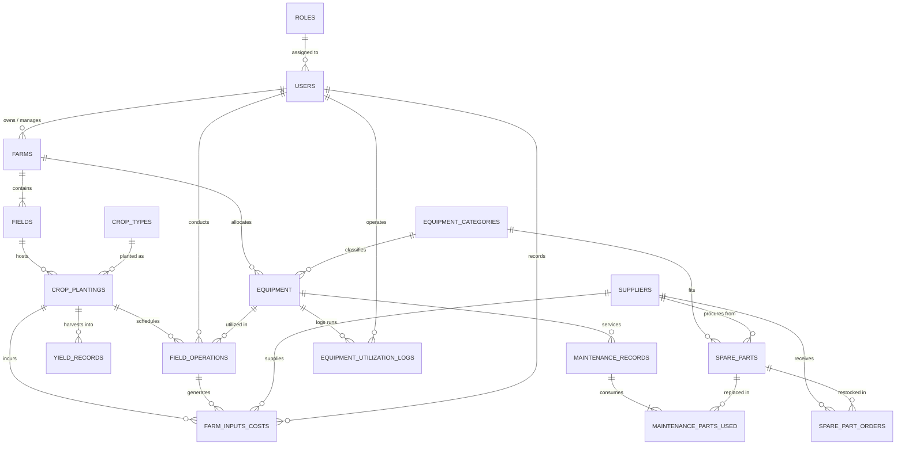

# HarvestHub - Entity Relationship (ER) Documentation & Schema Summary

## 1. Relational Schema Architecture (3NF)

The HarvestHub relational model is organized into **Master Entities**, **Core Operational Transactions**, and **Fleet & Inventory Asset Management** in compliance with Third Normal Form (3NF). Every non-key column is strictly dependent only on the primary key, eliminating transitive dependencies and update/deletion anomalies.

### Master Entities
1. **`roles`**: System permission classification (`ADMIN`, `FARM_MANAGER`, `FIELD_WORKER`, `AGRONOMIST`).
2. **`users`**: Platform stakeholders with encrypted credential hashes, role references, and contact coordinates.
3. **`farms`**: Agricultural landholdings linked to registered owners/managers with geographical coordinates.
4. **`fields`**: Subdivided agricultural parcels characterized by soil classifications (`Black Cotton`, `Alluvial`, `Red Soil`, etc.) and irrigation capabilities (`Canal`, `Drip`, `Borewell`, etc.).
5. **`crop_types`**: Standard crop taxonomy including botanical names, seasons (`Kharif`, `Rabi`, `Zaid`), maturity timelines, and benchmark yield figures.
6. **`equipment_categories`**: Functional groupings for heavy machinery, implements, and irrigation hardware.
7. **`suppliers`**: Agri-input distributors and genuine equipment spare parts vendors with GST registration.
8. **`spare_parts`**: Inventory catalog of consumable filters, belts, blades, and maintenance hardware with safety reorder thresholds.

### Operational & Transactional Entities
9. **`crop_plantings`**: Seasonal crop rotation instances binding a specific crop to a field with sowing, expected harvest, stage progression, and yield targets.
10. **`field_operations`**: Detailed agronomic tasks (`Ploughing`, `Sowing`, `Fertilizer Application`, `Spraying`, `Irrigation`, `Harvesting`) scheduled and executed by field workers.
11. **`farm_inputs_costs`**: Granular expense ledger capturing seeds, fertilizer units, fuel litres, labor man-days, and machine rentals in INR.
12. **`yield_records`**: Harvest results recording gross/net output in kg, quality grades (`Grade A`, `Grade B`, `Grade C`), mandi market rates, and gross realization.
13. **`equipment`**: Registry of farm tractors, harvesters, sprayers, and implements tracking operating meter hours, purchase capital, and maintenance health.
14. **`maintenance_records`**: Preventive servicing, breakdown repairs, and overhaul jobs with labor and parts costing.
15. **`maintenance_parts_used`**: Line-item ledger of spare parts consumed during equipment maintenance events.
16. **`equipment_utilization_logs`**: Shift-level operating logs tracking active engine hours, idle run-time, diesel consumption, and worked acreage.
17. **`spare_part_orders`**: Procurement purchase orders tracking vendor shipments and replenishment inventory.

---

## 2. Entity Relationships Summary

| Parent Entity | Relationship | Child Entity | Foreign Key Column | On Delete Action | Purpose / Business Rule |
| :--- | :---: | :--- | :--- | :--- | :--- |
| `roles` | 1 : N | `users` | `users.role_id` | RESTRICT | Ensures all active users belong to an authorized role. |
| `users` | 1 : N | `farms` | `farms.owner_id` | RESTRICT | Links ownership and managerial accountability of estates. |
| `farms` | 1 : N | `fields` | `fields.farm_id` | CASCADE | Parcels belong strictly to their parent farm. |
| `fields` | 1 : N | `crop_plantings` | `crop_plantings.field_id` | RESTRICT | Tracks multi-season crop history and rotations on each parcel. |
| `crop_types` | 1 : N | `crop_plantings` | `crop_plantings.crop_id` | RESTRICT | Associates agronomic specifications with each planting cycle. |
| `crop_plantings` | 1 : N | `field_operations`| `field_operations.planting_id` | CASCADE | Decomposes a crop cycle into chronological farm tasks. |
| `users` | 1 : N | `field_operations`| `field_operations.assigned_to_user_id` | SET NULL | Assigns task ownership to farm hands and tractor operators. |
| `equipment` | 1 : N | `field_operations`| `field_operations.equipment_id`| SET NULL | Binds farm machinery to field execution tasks. |
| `crop_plantings` | 1 : N | `farm_inputs_costs`| `farm_inputs_costs.planting_id` | CASCADE | Associates input expenses directly to the specific crop batch. |
| `field_operations` | 1 : N | `farm_inputs_costs`| `farm_inputs_costs.operation_id` | SET NULL | Ties variable expense (e.g. diesel, fertilizer) to a task. |
| `suppliers` | 1 : N | `farm_inputs_costs`| `farm_inputs_costs.supplier_id` | SET NULL | Tracks vendor purchases for inputs and chemicals. |
| `users` | 1 : N | `farm_inputs_costs`| `farm_inputs_costs.recorded_by_user_id`| RESTRICT | Audit trail for expenditure authorization. |
| `crop_plantings` | 1 : N | `yield_records` | `yield_records.planting_id` | CASCADE | Connects harvested produce output with its planting source. |
| `farms` | 1 : N | `equipment` | `equipment.farm_id` | CASCADE | Tracks machinery located at and allocated to each farm. |
| `equipment_categories` | 1 : N | `equipment` | `equipment.category_id` | RESTRICT | Classifies fleet assets by implement and machinery type. |
| `suppliers` | 1 : N | `spare_parts` | `spare_parts.supplier_id` | RESTRICT | Standard supplier for consumable maintenance items. |
| `equipment_categories` | 1 : N | `spare_parts` | `spare_parts.equipment_category_id` | SET NULL | Matches spare parts to machinery category compatibility. |
| `equipment` | 1 : N | `maintenance_records`| `maintenance_records.equipment_id` | CASCADE | Complete servicing history per tractor or implement. |
| `maintenance_records` | 1 : N | `maintenance_parts_used` | `maintenance_parts_used.maintenance_id` | CASCADE | Line items of components replaced in each service job. |
| `spare_parts` | 1 : N | `maintenance_parts_used` | `maintenance_parts_used.part_id` | RESTRICT | Depletes inventory upon maintenance execution. |
| `equipment` | 1 : N | `equipment_utilization_logs`| `equipment_utilization_logs.equipment_id` | CASCADE | Logs daily meter, fuel, and work output for machinery. |
| `users` | 1 : N | `equipment_utilization_logs`| `equipment_utilization_logs.operator_user_id` | RESTRICT | Operator responsibility tracking for machinery usage. |
| `suppliers` | 1 : N | `spare_part_orders` | `spare_part_orders.supplier_id` | RESTRICT | Purchase order dispatch to registered spares suppliers. |
| `spare_parts` | 1 : N | `spare_part_orders` | `spare_part_orders.part_id` | RESTRICT | Order items for stock replenishment. |

---

## 3. Mermaid Entity-Relationship Diagram

---

## 4. Test Validation Edge Cases Included in Seed Data

1. **Edge Case 1 (Empty Optional Coordinate & Boundary Attributes)**:
   - Record: `farms` (ID 10: `Vidarbha Agro Frontier`) has `latitude = NULL` and `longitude = NULL`. `fields` (ID 3, 6, 10, 15) have `boundary_geojson = NULL`.
   - *Test Objective*: Verifies that frontend mapping components gracefully fall back to tabular or placeholder views when GIS polygon data is absent.

2. **Edge Case 2 (Maximum-Length Text & Complex String Descriptions)**:
   - Record: `suppliers` (ID 12) contains a 112-character legal entity name: `"All-India Unified Apex Cooperative Agricultural Produce Marketing And Farm Machinery Federation Private Limited"`.
   - Record: `maintenance_records` (ID 53) contains a 350-character warranty inspection narrative.
   - *Test Objective*: Tests UI table overflows, truncation pills, and database column boundary integrity without truncation failures.

3. **Edge Case 3 (Homoglyph & Duplicate-Looking Entities)**:
   - Record: User ID 2 (`Ramesh Patil`) and User ID 12 (`Ramesh Patil Jr`) share similar names and operational domains but distinct IDs and phone numbers.
   - *Test Objective*: Validates that assignment dropdowns and search filters uniquely differentiate users via IDs rather than naive text matching.

4. **Edge Case 4 (Zero-Cost / Warranty Maintenance Transaction)**:
   - Record: `maintenance_records` (ID 53) with `labor_cost_inr = 0.00`, `parts_cost_inr = 0.00`, and `total_cost_inr = 0.00`.
   - *Test Objective*: Verifies that cost calculation aggregates (`SUM`, `AVG`) handle zero-dollar records without divide-by-zero or exclusion bugs.

5. **Edge Case 5 (Stock Exhaustion & Maximum Numerical Scale)**:
   - Record: `spare_parts` (ID 15: `CHN-ELEV-KUBOTA`) has `current_stock = 0`, triggering the low-stock alert threshold.
   - Record: `farm_inputs_costs` (ID 76: `Specialized Heavy Crane`) records a single entry of `₹1,25,000.00`.
   - *Test Objective*: Asserts inventory warning badge rendering and high-precision financial calculation formatting (`DECIMAL(12,2)`).
